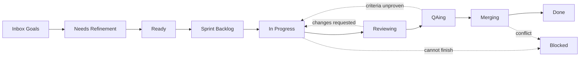
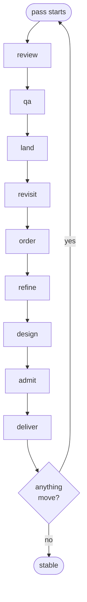

# Running the Crew

As of 2026-09-22.

An operator's guide to the crew, and an honest read on how close it is to a full agile organisation.

## What the crew is

An agile organisation run as agents, where the GitHub Projects board is the orchestrator rather than a report of one. A card's column is not a status someone updates — it is the queue a phase reads from, and moving it is how work is handed on.

Seven roles, each an agent with its own prompt, model alias and capability allow-list. One human: the Sponsor, who writes goals, approves epics, and reviews at sprint end.

| Piece | What it is |
| --- | --- |
| **Board** | GitHub Projects v2, organization-owned — a fine-grained token cannot reach a user-owned Projects board |
| **Issues and PRs** | Two GitHub Apps: one delivers, one reviews. GitHub refuses an approval from the identity that opened the pull request |
| **Model** | Qwen3.8-27B under SGLang on a DGX Spark, fronted by LiteLLM, 262,144-token window |
| **Sandbox** | Generated code runs in a container with no network and no capabilities. `required` by default: no engine means the run fails rather than falling back to the host |

Three repositories are in play. `crew` is the orchestrator itself and is deliberately **not** in `delivery.repos` — an orchestrator editing itself mid-run breaks the thing making the change. `sprint-metrics` is the pilot the crew actually builds. `infra` is where things run, worked the same way as any delivery repo, with the DevOps Engineer as its domain owner (crew#349, §20).

## The board

**Columns are queues.** A column names what a card is *waiting for*, never what is being done to it. A card sits in one for the whole of that phase's work and leaves when the phase is finished with it — so a card in QAing may be waiting for QA or being verified by it, and the board does not distinguish.



Solid arrows are the path. Dotted arrows are the ways back: a card returns to In Progress when either gate refuses it, and reaches Blocked from anywhere when only a person can move it.

| Column | Waiting for | Drained by | WIP |
| --- | --- | --- | --- |
| Inbox (Goals) | The Sponsor to approve or reject | a person | — |
| Needs Refinement | The Business Analyst to split it | refine | 8 |
| Ready | A sprint to admit it | admit | 16 |
| Sprint Backlog | A Developer to claim it | deliver | 16 |
| In Progress | The Developer to finish | deliver | 3 |
| Reviewing | The Code Reviewer to judge the diff | review | 3 |
| QAing | QA to verify behaviour against the criteria | qa | 3 |
| Merging | The merge — it is verified and approved | deliver | 3 |
| Blocked | A person | a person | — |

WIP limits are deterministic rules in `crew_org.process`, not an agent's judgement. A limit an agent can decide to ignore is not a limit.

Two human gates and no more: an epic awaiting approval in Inbox (Goals), and the sprint review, which reads the report a sprint records when it closes itself (ADR 0028). Admission to a sprint is **not** a gate — approving the epic was the scope decision, so filling the sprint from approved epics is arithmetic.

## A tick

`crew tick` runs nine phases until a pass moves nothing. One command takes the board as far as it can go. **Each pass moves the work nearest to done first** (crew#759): it reviews open pull requests and QAs what was approved, then lands what is approved and closes finished stories and epics, all before it refines anything. Landing still comes before every phase that judges a hold, so each hold is judged against the board as it now stands (crew#388). Refinement isn't skipped while work further along moves. In two ticks that hit the pass cap, something downstream moved in every pass, so they would have refined nothing. Delivery comes last, so it builds the stories admitted in the same pass rather than a pass later. When an open epic has no Rank, the `order` phase has the Product Owner order the repository's open epics and name any story that must now wait for the new work (crew#358).



**Drain-first.** Work already started is pushed forward before new work is refined or claimed: review, QA and landing come first, and delivery merges what is approved before it claims the next story, so a story never branches from a default branch missing its predecessors.

| Phase | Reads | Does | Writes |
| --- | --- | --- | --- |
| review | open pull requests | Code Reviewer judges each diff | a GitHub review; cards to QAing or back to In Progress |
| qa | QAing | Verifies behaviour against each acceptance criterion | a verdict comment; cards to Merging or back to In Progress |
| revisit | the event log's rebuilds, design pull requests, epics labelled `decision:to-log` | Architect revisits a project's design when one sprint's stories keep colliding in the same file; the crew merges its revision; each declared change that needs work is placed first: an open epic that delivers it gets it in its own text, a correction to the design's wording files nothing, and only a prerequisite no epic delivers becomes a technical epic (crew#192, crew#439); the Product Owner's decisions for every epic are written into the project's decision log by a pull request the crew merges (crew#468) | a design pull request, merged; technical epics to Needs Refinement; a decision log pull request, merged |
| refine | Inbox (Goals), Needs Refinement | Product Owner proposes epics; Business Analyst splits approved epics into stories. A project whose design is being revisited has its epics wait, except technical ones. With `refinement.look` on in `org.yaml` (crew#858; off, epics are split with no record), once none of a Goal's epics waits for the Sponsor, the Architect and the UX Designer look across them and the Product Owner settles that into the Goal's record, a comment on the Goal, with the Goal's target diagram beside it (`crew look`); the split then reads the rows that bind its epic. One Goal of a project refines at a time | new issues, cards to Inbox and Ready |
| admit | Ready | Fills the sprint from approved epics in priority order until capacity | cards to Sprint Backlog |
| deliver | Merging, then Sprint Backlog | Merges what is approved, then claims the next story and runs Developer sessions on it, one at a time, in its workspace container (ADR 0032) | merges, branches, pull requests |

**A failing phase does not end the pass.** Later phases act on the cards they can, and the failure is reported beside what did happen — a tick that aborts on the first error leaves the board partway through a state nobody chose.

**Quiescence is bounded.** Five passes maximum. A pass that keeps moving forever is a bug, not a busy board, and hitting the cap is reported as *stopped*, never as stable.

**A pass that moved nothing still waits for the merge queue.** GitHub lands a queued PR about a minute after it joins, and a pass that ended before that landed could call the board stable while the very PR a sibling story waits for was about to merge — each tick then finished only one story of an epic (crew#314). So a pass that moves nothing, but left pull requests in the queue, polls for up to 10 minutes before the tick ends; the summary reports the wait ("waited 70s for the merge queue: 2 of 2 left it"). A PR the queue removes counts as having left it, the same as a merge.

**GitHub's rate limits are honoured, not raced against.** Every GitHub request goes through a transport that paces writes a second apart and waits out a 429, a 403 rate limit, or GraphQL's `RATE_LIMITED`, as GitHub asks (`Retry-After`, the reset time, or a minute doubling), up to three tries. Past two minutes of waiting, the tick stops cleanly where it is, rather than racing GitHub's own back-off — the next tick resumes from the board as it stands. GitHub's own budget is recorded each pass and exported as `crew_github_requests_remaining` (crew#293).

## The roles

| Role | Produces |
| --- | --- |
| Product Sponsor (human) | Goals; epic approval; sprint acceptance |
| Product Owner | Epics |
| Business Analyst | Stories, tasks, acceptance criteria, estimates |
| Architect | Design notes, tasks, spikes |
| Developer | Code, tests, docs, pull requests, bugs, in a session of tool calls (ADR 0032) |
| QA Engineer | Behaviour verdicts, bugs |
| Code Reviewer | Diff verdicts, bugs |
| Scrum Master | Standups, retros, process defects |

Roles live in `config/agents.yaml` as data — goal, backstory, model alias, capability allow-list, and the constitution sections injected into the prompt. Changing how a role behaves is a config change reviewed like any other, not a prompt edited in passing.

**What is enforced rather than asked for.** A boundary that depends on granularity (goal vs epic vs story) or altitude (what vs how) is exactly what a small model blurs, so it is made structural:

- **Capability allow-lists.** A Product Owner *cannot* write acceptance criteria; a Business Analyst *cannot* redraw an epic.
- **Contract preservation.** The gates at `done` send back a branch that removes or reshapes a public definition merged callers use (`regression.draft_breaks`). Bodies and private helpers are free. The prompt asked for this first and the model did it anyway on the first attempt — a prompt is a request, this is a guarantee.
- **Merged tests.** A branch that changes or removes a merged test `done` doesn't declare goes back, with the test as merged. Deleted tests do not fail; they stop existing. `write_file` won't overwrite an existing file unless it's asked to.
- **No skipped test CI runs** (crew#860). The workspace runs the services a project declares beside it (a Postgres for sprint-metrics' database tests), each in its own hardened container on a network with no route out, read from the default branch so a story can't choose what the host runs; a project that declares none runs with no network, as before. Every pytest run writes a report, and at `done` a test the branch adds or changes that skipped and that the workspace file doesn't declare CI-only (`customizations.crew.ciOnlySkips`, each entry a test id or text in the skip's reason, crew#917) goes back. A merged test that skips, or a declared service that won't start, isn't the story's: it's filed as one DevOps finding per cause. Met again, the finding's Task gets a comment once per story, and a closed one is reopened. sprint-metrics#717 took four rounds because its database tests skipped in the workspace and only failed after the gate. **A project's first workspace takes three steps** (the Sponsor, 2026-10-23, crew#839). First, DevOps's Task writes the workspace file and its services. Its gate at `done` runs them, as its branch declares them, in a container of its own, under the same rules. A merged test they turn on that fails, in a file the branch didn't change, doesn't send the Task back. It's named in the pull request and filed as one bug for the Developer when the Task merges. Once a story's checks pass with the services up, DevOps gets its second Task, to make CI's test job run them too. **A card in Merging with changes requested on its head goes back to In Progress for rework**, as it would from Reviewing, whoever asked (crew#839): mqucifer/sprint-metrics#740 waited there with your request on it.
- **Every story adds its own changelog entry** (crew#816, ADR 0019). A story or a bug whose branch changes what the project ships, meaning anything but its tests, its docs (`docs/`, `*.md`, `*.rst`), its repository settings (`.github/`, `.crew/`, `.devcontainer/`, `.gitignore`) and the changelog itself, adds a line under `## [Unreleased]` in `CHANGELOG.md`, or the gates at `done` send it back with that reason. `done` checks it first, so a session adds the line without spending a gate round. A release ships what `[Unreleased]` holds, so a story that added none would ship unlisted. A project with no `CHANGELOG.md` isn't asked for one, and a role's Task is left out: DevOps's release moves the entries.
- **WIP limits and card movement.** Deterministic, in `crew_org.process`.
- **The Goal's record** (crew#583, crew#858, ADRs 0023 and 0036). One marked comment on the Goal holds what's decided for its epics, and every row says whether it binds, who set it, when, which row it replaces, and which epics it binds (`all`, or their refs); `flows/record.py` reads and edits it, and an epic reads the rows that bind it. An epic split before its Goal had a record keeps its own, in its body, until it closes. A binding row is never deleted or edited in place: a later row replaces it, set by the row's own author or the Sponsor, and the old row says what replaced it. An open question names who settles it, and is settled the same way, by a row that replaces it. Every edit re-reads the body and refuses if it changed, and posts one comment marked `crew:record-change` naming the rows it changed, by whom, for which card. **Answers edit the record** (step A3). The Product Owner's answer to a story problem is written as rows, adding or replacing its own, and the Product Owner is shown the record, its earlier answers included; a row the record's rules refuse is asked for again with the reason. **The Sponsor's replies on an epic become rows** (the Sponsor, 2026-10-10: "if I respond to an epic it should be recorded"): before each split, the Product Owner step enters every Sponsor comment since the record began as a binding row set by the Sponsor, its decision their words as written, and names the comment in its source so it is entered once. One on the Goal binds every epic; one on an epic, that epic. The split and the criteria check read the record, not the latest answer among the comments. **The merged tests an epic changes are rows too** (step A4): each test a story's Existing tests line declares as a contract change becomes a C row naming the story, and so does each merged test a story changed when the Business Analyst's ruling sent it back. A re-split has to carry every declared test into a story's Existing tests line or list it in `tests_dropped` with why; one that drops a test silently is split again once with it named, and fails if it still does. A dropped test stays in the record, marked with why. **A story's contract can change in delivery, by the Business Analyst** (crew#584, ADR 0032 decision 6). At `done`, when the story's Existing tests line says the merged tests stay unchanged and `done` changed some, the Business Analyst rules for that story alone: amend the line, when its criteria or rows require the change, and the branch goes on to review; have the change put back, when the story doesn't change that behaviour, and a new session gets that finding; or return the story to refinement with why, when it can't be done without changing that behaviour and shouldn't. An amendment or a return makes the tests C rows. **The retro reads the record, not answers paired by time** (step A6): a Product Owner answer names the story whose return it answers, and the retro pairs it with that return only, reading the decision from the record's change comment. An answer to a problem raised inside refinement, with no story returned, belongs to no return. Sprint 20's retro filed such an answer under sm#529, by time. Conclusions written in the earlier form are read as they are.
- **The split follows the record** (crew#440, crew#858). The Business Analyst is shown the rows that bind its epic apart from the epic's own text, and the Goal's target diagram. A story may not contradict a row and names the rows it follows in `follows`, which its issue carries as "Follows the Goal's R1, R4." ("the epic's" for one split from its own record). Every row is followed by a story or listed in `not_for_stories` with why it isn't for stories; a split that leaves a row out is made again once with it named, and fails if it still does. What the Architect decided in the Goal's look and what the reader sees are rows too, so the reader's criteria reach the stories. A question left to the implementer stays open, and no story's criterion settles it. A question a record from before the look still leaves for the Architect is split around the same way: the look decides such questions now, and nothing else answers them. **The criteria check reads the rows too.** Before any story exists, QA checks the split's criteria, one story per call (crew#583, step D3: checked all at once it thought 12.6k tokens to write 641 characters, at the edge where answers come back empty), against the split's other stories, the stories other epics plan, the code that story names, and now against the conclusion: a criterion that expects the opposite of a row is a conflict. One that decides an open question isn't (crew#860): that rule made 125 of 307 conflicts from 2026-10-01 to 10-21, and the Goal-level look settles open questions before the split. The check also sees the Goal and the project's decision log. **What each story's check is shown** (crew#839; sprint-metrics#752's re-check of one story ran 33 minutes on what its start left open): each story with what it builds on and the rows it follows; the Goal's epics in the order proposed, each with its status, and any binding row that orders them, which holds over the proposal; other epics' planned stories under their epic, each with its board status, the epic's status and whether it's in this Goal, with their criteria whole, no longer cut at 2,000 characters; and the record as that story reads it, the rows it follows in full and every other row on one line. A clash with another epic's planned stories is kept once, for that epic. **Merged tests that use what a story removes are listed in code** before any session: the names a criterion says are gone, removed, deleted, retired, renamed or not there, matched against each merged test's code, and compared with the story's Existing tests line by the gate's own reading of it. The split's `done` is refused once for the undeclared ones (declare them, or call `done` again if one doesn't pin what's removed), and what's left goes to the criteria check as facts; which way each went is counted on the split's note. **A conflict is repaired in place.** The Business Analyst rewrites the criteria of the stories the check flagged, and their Existing tests line where a conflict is a merged test the epic means to change, which is declared rather than written around; nothing else: the other stories, every title, the order, the rows followed and the dependencies stay as they were. Only the repaired stories are checked again, each still against all the others (crew#612: sprint-metrics#551's re-check of all ten stories took about an hour). A re-check is told the conflicts its first check found and each criterion the repair changed, before and after, and asked whether they're resolved and whether the repair made a new one; a flagged story the repair left as it was keeps its conflicts without a session (crew#839). The criteria check's note says whether it was a re-check, and each session's start event its parts' sizes. Each story's conflict with one merged test is reported once. A conflict that names a story the split doesn't have is split again whole, with the conflict named. One that survives either way goes to the Product Owner as a story problem, as any other conflict does (crew#428). On sprint-metrics#406 a whole re-split fixed the conflict it was told of and made a new one elsewhere, round after round, which is why only the flagged criteria are rewritten now. **Later steps get only the rows a story names, and the diagram.** The Developer, the Code Reviewer, QA and the deploy review are each shown just the rows of the record that the story's "Follows the Goal's R1, R4" line names, and any row that has replaced one since, under a heading with what the step does with them: build to them, judge the change against them, or hold a criterion unproven if the work rules one out. The epic's whole conclusion isn't passed down, so a long one doesn't bloat every story's context. A story that names no rows, or an epic with no record, adds nothing. The Developer, the Code Reviewer and QA are also shown the Goal's target diagram.
- **A project's own decision log** (crew#468). Decisions for every epic in a project live in its `docs/decisions/`, as ADRs. The Goal's look, its settle and the split are shown each Accepted entry's title and Decision section, and the look records how many characters it was shown.
- **No bare issue numbers in anything the crew posts** (crew#456). GitHub links `#123` and `GH-123` to that number in whichever repository the text lands in, and models copy numbers from their context. Every body the crew posts (issues, comments, pull requests, reviews, edits) goes through one guard in `IssueClient` first: a bare number becomes an explicit link to that issue in the repository it's posted to, and one that isn't an issue or pull request there is put in code and recorded. Code, HTML comments (the crew's markers and data), links already written and URLs are left alone.
- **A Goal's epics share what they decide** (crew#611, crew#858, ADRs 0023 and 0036). The Goal's look reads all of them at once, so a decision two epics depend on is one row of the Goal's record, binding both. In Sprint 21's dry run sprint-metrics#552's Architect, shown none of sprint-metrics#551's record, settled its schema differently. An epic added later gets the look for itself alone, against the record the Goal has. **One Goal refines at a time in a project** (the Sponsor, 2026-10-22): the epics of the other Goals wait, naming the one refining; one that has begun keeps its turn, otherwise the first in admission's order goes. The next Goal can be proposed and approved meanwhile, and a technical epic is never held by it.
- **Roles open their own Tasks** (crew#839, ADR 0034). A Task is the board's `Task` work type, owned by a role and named by its `role:` label; it's admitted like a bug and needs no approval from you to start. These open one:
  - **A Goal's epics are all done:** the Architect's Task makes the Goal's target diagram the repository's, `docs/architecture.md`, corrected to what was built, with where the build differs from the target. The Goal closes once that Task is done too.
  - **A repository has no diagram:** the Architect's first Task draws it. The first tick after this landed opens one in each worked repository.
  - **A repository has no workspace file** (crew#860): DevOps's first Task writes `.devcontainer/devcontainer.json` and the services its tests need, names the skips CI makes too. DevOps keeps the file true (you, 2026-10-22). Not while the repository waits on its walking skeleton.
  - **The first workspace Task is closed and main passes with its services** (crew#839): DevOps's second Task makes CI's test job run the same services. A story passing at `done` with them opens it, or each pass runs main's whole checks in a container with its services, once per head commit, kept in `var/ci-services/<repo>/<sha>.json`. A container that didn't start or a setup that failed isn't kept, so the next pass tries that head again. Once the Task is there, a pass starts nothing.
  - **A Goal's look names a new service or toolchain** (crew#860): DevOps's Task for it, under the Goal. The Architect names it as intent ("a Postgres for the tests"); the Task works out the image and the declaration.
  - **An epic is split:** DevOps's Task for the epic's CI and release, one per epic, in place of a release story; the split refuses a story that cuts the release. It waits for every story of the epic. It's titled as a release, "Release for epic owner/repo#n", and its pull request adds the version its changelog moved to; the Code Reviewer is told it's a release, judged on the changelog, the version and CI, not the epic's story work (crew#948). One the split couldn't open is opened by the next pass, which looks for an epic split since this was built with no release Task under it.
  - **A release goes live** (crew#830): the UX Designer's review Task, one per repository and version, for a project GitHub has a Pages site for and whose record names a reader (`serves`). Live means the version's tag has a GitHub Release and a Pages deployment succeeded after it was published, so a deploy that only refreshes the data opens nothing.
  - **An alert fires** (crew#893): DevOps's Task in mqucifer/infra, one per firing of each Grafana alert labelled `audience: crew`; your alerts (`audience: sponsor`) page you and open none. Each pass reads them with the read-only token in `~/.config/infra/grafana.env` and applies nothing. A firing again while its Task is open, and an alert that stopped, are comments on it; the Task stays open until DevOps's review is done. Its scope there is `grafana/`, `inventory/`, `runbooks/` and `compose/`, and what merges is yours to apply. Grafana unread is a held line on the standup; a day of it is DevOps's finding.
  - **A producer announces a new major** (crew#960, ADR 0008 in mqucifer/project-print): the Architect's Task in each project whose record `uses` that producer and pins a release at the major it replaces, one per project, producer and version, never filed again once closed. It's filed in Needs Refinement for the Business Analyst's triage, as a finding is, titled with what replaces what and when ("delivery-history 2.0.0 replaces 1.x on 2026-11-06"); its body has the producer's changelog for that version whole, the date, where the new contract's schemas and mock are, and the version the project pins now. Each pass reads it from the producer's `announced.json` beside the contract files the record names, never from a list in the crew (the README's "Data packages: how projects use them" says the convention). A producer that publishes none files nothing, and the pass notes it; nothing is filed in the producer's own repository. `crew announced <project>` shows what a pass would file and opens nothing.
  - **A role's finding outside its story:** the Code Reviewer, DevOps's deploy review and QA each put what they see outside the story in their verdict's `outside` list. Each is filed for its owner: a Task in Needs Refinement, which the Business Analyst triages as a bug, or a bug. At most one per owner for each story and round, and every filing is an event (`finding.filed`).

  The role's session works the Task through the Developer's path with the role in the Developer's place: it may change only its role's area (the diagram file; CI, the changelog, the version and image files; in infra, what runs), the gates run at `done`, the Code Reviewer reviews it and QA passes it on. The diagram and the release wait for your approving review before they merge; a Task from a finding merges after the Code Reviewer, as a bug does. **The UX Designer's Task is worked by its review session instead** (crew#830): it reads the code and `look`s at the published pages at the readers' widths, judging them by Nielsen's 10 usability heuristics and the WCAG 2.2 success criteria `look` can see (not contrast). Each correction names its page, width and standard, and is filed with its screenshot (uploaded to the reviewed Release) as a bug or a Task for its owner, up to ten per owner. Then the Task is closed and Done, with no pull request; it never blocks a merge. One that can't be worked is blocked for a person.

  **QA's Tasks are its tests, in mqucifer/qa-suite** (crew#896, M10; ADR 0006 in mqucifer/project-print). qa-suite has a folder per project, and its main runs against every pull request of that project as the `qa-suite / qa` check. QA's Tasks are filed there, each labelled with its project and allowed to change only that folder. Its session reads the project at `.project/<project>/` in its worktree, which is never committed. It's told QA's role for writing and fixing tests (`qa_engineer.tasks` in `agents.yaml`, crew#944), not the verifier's text, which stays for verifying a story. **A tick on a project does that project's QA work** (crew#945): `crew tick --repo crew-presentation` opens crew-presentation's QA Tasks, works them, reviews and lands their pull requests in qa-suite, and settles its stories waiting on a dispute, while leaving other projects' Tasks alone. It does that whenever qa-suite is in `delivery.repos`. A bare tick works them all, as before. Three things open one:
  - **A story merges** in a project with a folder in qa-suite: the test of its criteria, through the surface the folder's README names. It opens after the merge, not at the split: a test of work not yet on the project's main would fail every other pull request there. Before the merge, QA's session verifies the story. **Test Tasks start on a day the operator sets** (crew#945): `delivery.qa_tests_from` in `org.yaml`. While it's empty none open, and once set, only work merged on or after that day opens one, with no backfill. It stayed empty until you and the operator had reviewed one test Task's session start, rendered by `crew qa-start` (crew#944), and is set to 2026-10-30.
  - **An escaped bug's fix merges:** the test that would have caught it. Triage accepts a bug only when it contradicts accepted behaviour, so each fixed bug is one.
  - **A Developer disputes a test.** When `qa-suite / qa` failed on its pull request's head, the Developer's session may end `blocked` with kind `test`, naming the test and why it thinks the test is wrong. That opens QA's dispute Task, and the story waits on it in Blocked, labelled `waits:qa`. It isn't sent back, and it isn't listed as waiting on a person.
    - If QA fixes the test, its pull request's check runs the fixed test against the disputed pull request's head, not the project's main (crew#945). Against main, a fix that needs the story's change could never pass. Once QA's pull request is approved, an empty commit runs the story's checks again, now with QA's tests, and the story goes to review, labelled `lands-with:qa`. **The story lands first, and QA's pull request straight after:** the story waits until QA's is approved and green, and QA's waits until the story has landed. Without a merge queue the two merge seconds apart; with one, QA's lands on the next pass. qa-suite's side is its `suite.yml` and `qa.yml` (mqucifer/qa-suite#11).
    - If QA justifies the test, the story goes back to the Developer with the test unchanged and QA's reason, given as CI's verdict, so the Developer changes the code.
    - A test already justified, and unchanged since, opens nothing when it's disputed again. The session is told "already justified", with the Task's link.

  QA's pull request runs its changed folders against each project's main (qa-suite's `suite.yml`), or a dispute's against the disputed pull request, so a red test comes back to QA before it fails anyone else's. QA can end with no change and no pull request:
  - `no_test`, when nothing the Task asks can be reached through the surface;
  - `justified`, on a dispute.

  Either way it's recorded as `role_task.settled` with its rule, so the retro sees how often the surface falls short.
- **One story at a time per epic, and across epics that share ground.** Siblings extend each other, so delivery holds a story until its earlier sibling has landed. Refinement is shown the project's completed stories and what their criteria delivered, so decomposing a Goal or splitting an epic doesn't propose one already built; a number that isn't a delivered story fails the split, and an epic wholly delivered closes rather than being split again (crew#220). A split is also shown the open stories other epics in the repository already hold, including ones split earlier in the same pass: one it would duplicate is named `already_delivered` the same way. An epic covered only by planned stories waits for them: it closes once they land, and is split again if one is closed without landing, since a planned story can still be superseded (crew#329). One it needs is named in `builds_on`, which delivery holds it for the same way siblings are held (crew#295). **Planning honours the same hold** (crew#353): a story is deferred, not admitted, while an earlier sibling or anything in its `builds_on` neither lands this plan nor is already on its way (Sprint Backlog through Merging), and a story an earlier sprint admitted but never started is returned to Ready, its Sprint cleared, so it plans again with its siblings instead of sitting in Sprint Backlog for good. **A story whose epic is in Inbox (Goals)** waits with it: one not yet admitted stays in Ready, and one admitted but not started goes back to Ready, so parking an epic parks its stories too (crew#673). **Technical epics are planned first** (crew#358), the way refinement already takes them ahead of a Goal's own priority order (§13, crew#192). **A story a rework supersedes, closed as "not planned,"** frees its points back to the sprint rather than spending them on work that will never be built (crew#327).

**And the counterweight.** Before adding a rule, ask whether the agent was *shown* what it needed to follow the rule it already had. Every context defect found on 2026-09-19 was prose compensating for something an agent could not see. The Developer, QA, the Reviewer, the Product Owner and the Business Analyst all now read the whole repository — the pilot is 3% of the window, the crew itself 40% (re-measured 2026-09-22).

## Running it

Start here, in this order. The first two change nothing.

```
uv run crew doctor                                    # through the proxy: is the model serving, and can it call tools
uv run crew auth                                      # are both identities correctly scoped
uv run crew tick                                      # the whole loop, and it lands what it produces
```

| Command | Changes | Notes |
| --- | --- | --- |
| `crew doctor` | nothing | Probes through the LiteLLM proxy (`CREW_LLM_BASE_URL`, with its key) as `crew-local`, the path every tick takes. Checks the endpoint, chat, tool calling, constrained JSON, context length and thinking control. `--deep` adds a CrewAI round trip. Also says whether Mermaid's parser can run: a warning while its image or packages aren't fetched yet, which the first check does, and a failure with no container engine (crew#922) |
| `crew auth` | nothing | Verifies the delivery identity's scope and that the reviewing identity is a different one. See the note below |
| `crew tick` | the board, GitHub | Refines, admits, reviews, verifies, opens pull requests and merges approved ones. Ends with a standup on the sprint's `standup` issue |
| `crew tick --demo` | nothing | Renders the live view from synthetic events. No model needed |
| `crew tick --passes N` | — | Caps the passes. Useful the first time you run it against a changed board |
| `crew deliver`, `review`, `qa` | the board, GitHub | The individual phases, still available |
| `crew sprint start --dry-run` | nothing | Shows what would be admitted and why |
| `crew sprint close [--early]` | the board, GitHub | Closes a sprint by hand. A tick already closes one when its time is up, at the tick's start or end (ADR 0028), so this is for closing early or a sprint no tick has closed. Merges what you approved, carries approved unmerged stories to the next sprint, records the retro as an issue, once per sprint, and releases the delivery-history package, up to that sprint and none after it even when closed `--early`, saying on the retro which, or why not (crew#724, crew#738). A release that didn't happen is recorded as `release.failed`, named in the tick's standup, and said on the retro once, not once a tick (crew#889). A tick's own close does the same, and each tick releases one for the last sprint that ended if none is out since. Refused while the sprint's dates run on, unless `--early`; a sprint with a retro admits nothing more (crew#193) |
| `crew sprint retro --preview [--sprint NAME] [--out FILE]` | the board, GitHub (reads only) | The retro exactly as it would be recorded, for any sprint, past or current, even one already closed. Records nothing, merges nothing, moves nothing (crew#193) |
| `crew package schema` | `contracts/` | Writes `delivery-history`'s schema from its model, and its mock: a whole package built from illustrative inputs under `contracts/delivery-history/mock/`, for crew-presentation to build against before the first release. Fetches sprint-metrics' published schema at the release the crew runs into `src/crew_org/packages/upstream/` when it isn't there, and embeds it for sprint-metrics' answers. Refused when the schema changed and `SCHEMA_VERSION` didn't (ADR 0021, crew#521) |
| `crew package build [--out DIR]` | `var/packages/` | Builds `delivery-history` from the event log, the board and GitHub, up to today (sprints the board plans ahead are left out): its index, one events file per sprint, its manifest and its schemas, and an archive of them, with sprint-metrics' answers for every sprint it covers, asked of the service at `sprint_metrics.url` and checked against its schema. A service that doesn't answer, or answers in another release's shape, is said, and the package is built without them. Releases nothing. Events it can't place in a repository, or a session's event that's malformed, are left out and counted in the manifest, never guessed. A session with no end, or an end with no start, is built around and counted as a gap (crew#778) |
| `crew package release [--dry-run]` | GitHub: the crew's Releases, and a pull request on each consumer | Releases `delivery-history` (ADR 0021, crew#521): builds it as `build` does, tags it `delivery-history-<date>` (`-2` for a second that day) with its archive as the Release's asset, prunes the archives of releases beyond the latest seven and each month's first, and opens a pull request on crew-presentation that changes only `delivery-history.tag`, closing the one it supersedes. It carries the sprints up to the one that ended last, never one under way (crew#738). Refused unless sprint-metrics answered for every sprint it covers. `--dry-run` says what it would do |
| `crew package push [--url URL] [--dry-run]` | the sprint-metrics service | Pushes the crew's history to sprint-metrics (crew#280): every sprint, then each story's events, translated from `delivery-history` so only what may leave the crew goes. Started, blocked, unblocked, a missed attempt, escalated and finished, each in the sprint whose day it falls in. For a story delivered in Developer sessions, its attempts are the times it reached review and QA, and each return by review or QA is a missed attempt (`REVIEW` or `QA`); the gate's returns before review aren't (crew#778). A story closed as not planned goes as superseded (sprint-metrics 1.3.0), with the reason its epic was split again. Safe to run again: the service stores an event once. What it can't place is left out and counted: events between sprints, cards the history doesn't know, and a superseded story with no reason recorded |
| `crew moves [--people]` | nothing | Every card movement on the board and who made it: the crew, the platform (`board.yml`), or a person, named. Read from GitHub's own history, which has recorded almost none since 2026-10-02 (checked 2026-10-08); the tick's own record of others' moves is `card.seen_moved` (crew#521) |
| `crew qa-start <repo>#<n> [--bug] [--out FILE]` | nothing; GitHub (reads) | QA's test Task's session start for a merged story, rendered without opening the Task or calling a model (crew#944): its system prompt, first message, tools and `done`. Name the story, not its pull request; `--bug` renders a bug's fix as the test that would have caught it. It clones qa-suite and the project, both public, into a folder it removes, and places the project at `.project/<project>/` as delivery does. For the review before you set `delivery.qa_tests_from`. Run it from the checkout that holds `.env` |
| `crew announced <project> [--ref REF]` | nothing; GitHub (reads) | What a pass would file in a project for its producers' announced majors (crew#960): each Task's title and body, or the one already filed, and the producers that publish no announcements. Opens nothing. `--ref` reads the producers' announcements at a branch, to see what one not yet merged would file. Run it from the checkout that holds `.env` |
| `crew decisions <repo>#<n>` | nothing | What the Sponsor has decided for a Goal, as the Goal's look and its settle are shown it (crew#440, ADR 0015); the split and the gates read the record instead: their comments and decision log on the Goal's cards, and, in the crew's and delivery repositories, their comments naming the Goal and the body sections of their issues headed with "Sponsor" (for example `(Sponsor, 2026-09-29)`). The rest of an issue's body isn't counted, because defect reports cite Goals as evidence. A comment carrying a crew marker or Claude's `<!-- claude -->` is skipped, whoever posted it. Read-only. Names any repository the App can't search |
| `crew look <repo>#<n>` | the model; GitHub (reads) | Runs a Goal's look (crew#858, ADR 0036) on its open epics the Goal's record doesn't cover yet: the Architect and the UX Designer each read all of them, both at once, in a session over the code at the default branch (ADR 0033), against the Goal, the Sponsor's decisions (`crew decisions`), the project's decision log, and the Goal's record and target diagram if it has them. The Architect gives what the code supports, its decisions across the epics, the risks, any call beyond the Goal and the Goal's target C4 diagram; the UX Designer, the reader, what they meet per epic, what's missing and the criteria. Prints both; writes nothing. The Architect's diagrams are checked by **Mermaid's own parser** (crew#922), every block, and the finding is Mermaid's message as GitHub shows it; five things it parses and draws wrong (an open quote, a relation without its label or to an alias nobody defined, an alias defined twice or with a space) are checked after it. It runs in the sandbox with no network, read-only, the diagrams on stdin: the pinned `node` image in `mermaid.IMAGE`, with `mermaid` and `jsdom` installed once by `npm ci` from `src/crew_org/mermaid_parse/package-lock.json` into the sandbox's cache, as `look` installs Playwright. To move the version, change `package.json`, regenerate the lock with `npm install --package-lock-only --ignore-scripts` in that image, and the next check installs it. A parser that can't run is a problem named, never a pass. A tick runs the look itself, with the Product Owner's settle into the Goal's record, while `refinement.look` is on in `org.yaml`. It replaces `crew panel` and `crew settle` |
| `crew revert <pr> --reason "…"` | GitHub | Opens a pull request undoing a merged one. It lands through review and `deliver` like any change |
| `crew onboard <repo> [--from <file>] [--terminal] [--skeleton]` | GitHub | The crew's takeover of a project (ADR 0030): refused below readiness level 2, with what's missing. The Product Owner interviews you about it, in a local page (or the terminal), and proposes its record, `.crew/project.yaml`, as a pull request to that project. `--skeleton` is for a project the crew starts itself: not refused, and its walking skeleton is filed as its first Goal. See below |
| `crew ready <repo> [--setup]` | GitHub (read only); the sandbox with `--setup` | How far a project is ready for the crew (ADR 0030): level 1 for its walking skeleton, level 2 for any Goal, then the handover check (crew#757), with each missing item and who fixes it. Exits non-zero below level 2 or with anything missing. `--setup` starts the project's workspace on a copy, as a session's, and runs its setup there. See below |
| `crew design <repo> [--reason "…"]` | GitHub | The project's Architect proposes its `design` section (toolchain, check commands, release mechanics) as a pull request to the project, once the Code Reviewer finds no conflict with the guidelines. See below |
| `crew export <repo> [--sprint …] [--out …]` | nothing | Writes a sprint's stories and their attempts as JSON for sprint-metrics to read (crew#157). For each story: whether it landed first time, and each retry's failure class, role, cause and first error line. It also includes the causes across stories and how many went back to the Business Analyst |

**It lands what it produces.** There is no dry mode. A rehearsal cost the same inference as the real thing, left nothing that could land, wrote no event log at all, and put cards back where it found them — which was three of the five backward moves in the crew's own log, and noise `crew capability` had to filter out of the crew's self-knowledge.

What made landing frightening was having no way to undo it. The answer is a revert (crew#83), not a rehearsal. `crew sprint start --dry-run` stays: it shows what would be admitted and costs nothing.

**What the Code Reviewer is shown.** Beside the diff (crew#160): the checks GitHub ran on the pull request's head, what delivery reported from its own sandbox run, and the project's own modules that the changed files import, as they are on the base branch. Imports are followed through re-exporting packages, up to a size limit past which whole modules are named rather than cut. A diff of tests alone no longer looks like tests that must fail when the code they exercise has already landed. It's also shown who imports the other way: for each top-level name a diff's changed files add or remove, every other file that imports it, resolved from the repository at its base branch the same way the regression guard resolves imports. An import nothing in its own file uses, that another file imports from it, is shown as passed along rather than reported as unused (crew#215).

**Design happens in the Goal's look** (crew#858, §13). The Architect decides what across a Goal's epics would be expensive to reverse, before any is split, and draws the Goal's target diagram as a comment on the Goal; there is no design phase, design note or design threshold any more. An epic split before then keeps its notes, and the Developer and the Code Reviewer are still shown them.

**Why work doesn't land first time.** Every return by review or QA is recorded with what went wrong, as every retry of the one-call Developer was (crew#157); a Developer session's runs are its own records (crew#778). A failure becomes a *cause* by keeping the rule and masking the names, paths and numbers, so the same mistake counts the same wherever it happens. At sprint close the retro is shown the first-try rate and the causes. A cause seen on two or more of the sprint's cards is filed as a crew defect, with its count and cards, unless one is still open for it. A recurring parse failure is filed as a prompt or schema defect. Two kinds of cause are counted but never filed as recurring: a test's own assertion failing, because that's the card's wrong answer, and a failure whose cause wasn't recorded. A cause a fix solved during the sprint isn't filed again, if every occurrence came before the fix (crew#199). The fix is a retro finding for that cause closed as completed, or a merged crew pull request whose body carries the cause's marker, `<!-- crew:cause:KEY -->`. The retro prints each cause's key. Only occurrences after a fix count as evidence it recurs. `crew export` writes the same data for sprint-metrics.

**The retro's layout.** The sprint-close retro issue is laid out by the crew, around the Scrum Master's words (crew#176). It has these sections:
- **Delivered:** a sentence, plus a table of the sprint's stories and points built from the board. A story closed as not planned shows as **Superseded**, not Done, though GitHub moves it to Done, and the totals leave it out (crew#558).
- **Superseded:** each superseded story, its points, and the re-split that replaced it: at the Sponsor's request or after a story problem, read from the event log. A superseded story is a plan that didn't hold, so it's called out rather than dropped. Left out when there are none.
- **How it went:** at most six bullets.
- **Why work didn't land first time:** the first-try rate and causes. The rate is over the stories that landed. A superseded story's failures still count as causes.
- **Needs you:** blocked cards past the threshold, the approval queue as a count and range, and anything else raised for you. It says "Nothing." when there's nothing.
- **Defects filed.**

A filed defect's title is a short statement of the problem, under 80 characters. The retro is also shown the crew issues **fixed during the sprint** (crew#174), counted from when the sprint's standup issue opened. It cites those instead of filing them again.

**Work sent back.** When the Code Reviewer requests changes, the story is reworked on its own branch: brought up to date with `main`, then the findings are answered on top of the previous attempt, and the same pull request is updated. If other work has merged into the same lines in the meantime, so the branch conflicts with `main`, the story is rebuilt on current `main` instead of blocked (crew#158). It's being rewritten anyway. The Developer is told why and shown the findings, the branch is replaced (force-with-lease, so only the crew's own refused attempt is overwritten), and the PR gets a comment naming the conflicting paths. If the findings are already met by the code as it stands (another story may have landed the work first), the Developer can answer with evidence for each finding instead of inventing a change (crew#161). The checks run on the branch as it is, and the answer is committed empty so the PR's head moves. The evidence is posted on the PR, and the Code Reviewer is shown it when it reviews again. A second answer of that kind on the same PR goes to a person, with both the review and the answer quoted, rather than looping. An **approved** PR that conflicts with `main` at merge first has both sides kept, where each only added lines at the same place (crew#436): its own changes are as approved, and CI runs again on the new head. Otherwise its conflicts are resolved, not the story rebuilt (crew#933): main is merged into its branch with the conflicts left in the files, and one Developer session resolves them so both changes hold, such as two stories' `api_version` moves made one move to the newer number. It is shown each conflict's two sides, the base they share and the commits on main that changed the file, with the story's approved diff to read, and it can edit only the conflicted files: any other edit is refused at the tool, and checked again at its `done`, which also refuses a conflict's markers left in. Its `done` commits the merge onto the approved head, the gates run on the branch as at any `done`, and the push says so on the pull request with a marker. CI runs on the new head, and review and QA judge only what changed in those files since the approval, not the whole story. The event log records `merge.resolved`, with the files and the calls it took; a resolution isn't a rebuild, so it neither counts towards the two rebuilds nor as strain for the Architect. A session that ends other than `done`, a gate's finding, or an edit beyond the conflicts falls back to a rebuild the same way (decided 2026-09-25), told why the resolution failed. A role's Task is rebuilt as before. The return's comment and event name the conflicting files and the commit that landed in them first. The rebuild waits to start while another story's open pull request still changes those files, so it doesn't conflict again the moment that one lands. A pull request that is itself waiting on a rebuild, or whose story is blocked, holds nothing. sprint-metrics is one module, and parallel epics touch it together, so this is routine rather than rare. The rebuild costs model time, not a person, and the rebuilt PR goes through review and QA again, so nothing lands unreviewed. After two rebuilds of the same PR it goes to a person instead of looping. A revert that conflicts still blocks for a person.

**Landing through the merge queue.** Where a repository's `main` has a GitHub merge queue, an approved PR joins the queue instead of being merged by the crew (crew#302). GitHub tests each PR on top of the ones ahead of it and merges them in the order they joined. Without the queue, every merge left the other approved PRs behind `main`: they were brought up to date, and the next merge put them behind again. The card stays in Merging while its PR is queued, and moves to Done once GitHub has merged it, often by the board's own automation before the crew looks again. So the event log records a PR joining the queue, and the board records when it merged (crew#302). **The crew closes what it merged, rather than trusting GitHub's own `Closes #N` keyword** (crew#381): sprint-metrics#339's pull request carried the keyword, GitHub never linked it, and the card reached Done with its issue still open. Each pass, a Done story whose issue is open and whose pull request merged is closed. An epic is read as finished from its children on the board — one that isn't Done holds it — and GitHub's own sub-issue count is only the fallback for a parent with none on the board, because that count can be wrong: it read one of two for an epic whose two children were both closed and Done, and held everything waiting on it. A PR the queue removes for a conflict is rebuilt like any approved PR that conflicts. **A red CI check goes back to the Developer with its log** (crew#325). That covers a check that failed on the PR's head, which can't join the queue, and a check that failed on the queue's merge group. **It goes back before review too** (crew#756): a crew pull request whose head CI failed returns with the log before the Code Reviewer sees it, and review waits while CI still runs on the head. Of 17 reviews that requested changes, 4 were on a head CI had already failed. A pull request without a card is reviewed whatever CI says. The crew's own checks run lint and tests in a sandbox with no network, so what only CI runs, such as an image build or a release workflow, is proven nowhere else. The failing step of the job's log goes on the PR, marked with the head it judged, and the card goes back to In Progress. Before the step come the job's services, when it has any (crew#839): each one's state as the runner last logged it (started, healthy, or what failed) and the last 10 lines of its own log, in at most half the log's room. mqucifer/sprint-metrics#748's session read a failed connection as a container that hadn't started, when it had started healthy. The next delivery reads it with the review and QA verdicts and works on the same branch. **The same failing tests, three returns running, block the card instead** (crew#944): the third return goes to Blocked, labelled `blocked` and `needs:human`, with the log on the card, and no session starts. QA's sessions 2 to 4 on mqucifer/qa-suite#8 were each sent back for a failure the session had already explained. The stop is `delivery.ci_same_failure_stop` in `org.yaml`: it starts at 3 and is lowered from the `work.sent_back` records. A return whose log names no failing test is never counted as the same. A role's Task goes back to its own role, not the Developer. QA is shown the checks on the commit it judges, so a criterion only CI can run is proven by naming the passing check that runs it. A check proves only what its steps execute: sprint-metrics#260's QA cited `tests`, which never runs `release.yml`, as proof of the release workflow's behaviour. **A workflow that fails on a default branch after merge becomes a technical epic** (crew#335, the first DevOps duty). At the start of each tick's revisit phase, the latest push run of each workflow on each delivery repo's default branch is read. One that failed gets a technical epic, one per workflow while it's open, carrying the failing step's log. It skips your gate and holds that project's product epics until it lands, like any technical epic (crew#192): a red `main` stops the line. If the workflow passes again before any work started on the epic, the watcher closes it. **A release is checked for what it actually published** (crew#335). Once the release workflow's run for the default branch's head has finished and the version isn't `0.0.0`, the check reads GitHub and GHCR: the tag, a GitHub Release whose notes carry the version's CHANGELOG entries, and the image for amd64 and arm64. It also checks that `X.Y` and `latest` point at the same image, that a GitHub artifact attestation exists for its digest, and that the image carries its `org.opencontainers.image.source` label. A missing tag is one gap, not three — without it there's no Release and no `CHANGELOG.md` to read at it either, so those aren't listed as separate misses (crew#384). Any gap becomes a technical epic, one per version, titled "was never published" when the tag doesn't exist and "published less than the design asks" when it does, because a green release run can still have published less than the design asks. **Except one.** The registry is read anonymously, and a package GHCR reports as private or missing is a setting only its owner can change, on the package's own settings page — no API or workflow token reaches it, so no story could act on it (crew#386). That gap alone files no epic: the tick reports it as waiting on you, and the check looks again next tick. Found alongside real crew work, it's still named on the epic, apart from what the crew can do. **Unless the image is private by choice** (crew#398). The project's record can say `image: public` or `image: private` under `intent.release`, and that's your call. When it says private, an image the check can't read is skipped with a note, never reported as your step; the tag, the Release and the changelog are still checked. With no answer, or `public`, it stays your step as above. Job logs are read with the crew's own token. That works for a public repository; a private one needs the App's Actions: Read-only permission. Without a merge queue, the crew merges directly as before, and brings a PR that is behind `main` up to date first. Either way, a PR whose mergeability GitHub is still working out is read again before anything is tried, rather than merged blind.

**Undoing a change.** `crew revert <pr> --reason "…"` opens a pull request on a `revert/<pr>-…` branch. It is reviewed like any other change, and the deliver phase merges it once approved. When it lands, whoever merged it, the card whose work it undid is reopened and returned to Needs Refinement with `needs:human`, because the work is not done. A revert that does not apply cleanly is never forced: the card is blocked with the conflicting paths named. Each step is a `revert.*` event recording the pull request reverted, its card and the reason.

**Two identities.** The delivery app opens pull requests; the reviewing app judges them. GitHub refuses an approval from the identity that opened the pull request, so one app could only ever comment on the crew's own work and every story stalled waiting for a person.

> **Resolved, verified 2026-09-22.** The reviewing app's approvals count, and
> the crew merges its own work end to end. sprint-metrics PR #66 was approved by
> `mqucifer-crew-approver[bot]`, GitHub recorded `reviewDecision: APPROVED`, and
> it merged during the Sprint 3 run.
>
> This is written from the live answer rather than from a card. An earlier
> version of this page said the permission was still an open Sponsor decision;
> it was reading crew#40's issue body, which described 2026-09-19 and was never
> updated when the access changed. The issue text outlived the fact.
>
> crew#40's code still earns its place: `crew auth` states what it verified
> instead of concluding what it has not tested, and a pull request GitHub
> reports as `REVIEW_REQUIRED` despite an approving review is blocked and
> labelled for a person rather than waiting forever. That is now a guard
> against a regression instead of a description of the present.

**Onboarding a project.** `crew onboard <repo>` is the crew's takeover of a project (crew#757, ADR 0030). A new project starts from an alpha Claude builds, with its record's `intent` agreed with you while building and written by Claude in the alpha's pull requests, which you merge. Once `crew ready` reaches level 2 with nothing missing, `crew onboard` takes it over; below level 2 it refuses, naming what's missing, before any interview. `--skeleton` is for a project you want the crew to start itself, which has nothing to be ready yet. The onboarding is an interview in a local page, which it opens in your browser: the conversation with a field for each question, and the record building beside it. The page is served on 127.0.0.1 only and every request carries a token from its URL. Ctrl-C in the terminal ends it and keeps the answers. `--terminal` runs the same interview at the prompt instead. If the project has content, the Product Owner reads it (README, code, CI workflows, branch protection) and proposes answers for you to confirm or correct. If it has none, it asks. It is shown the project's open issues as well as its code, and tests your answers against both: it keeps asking while an answer is missing, vague, or at odds with the project. You can answer, tell it an answer is fine as it is, or reply `done` to go straight to the record (a missing required answer still has to be given). On your yes it opens a pull request, assigned to you, adding `.crew/project.yaml` to the project, with the interview folded into its description, and the files every crew project has from `mqucifer/project-template` (crew#690, ADR 0030): CI that runs what the design names (`.github/workflows/checks.yml`), the board automation (`board.yml`) and a `.gitignore`. The crew's own files are proposed whenever the template's differ; the rest only when missing. The record's `uses` names another project's output it uses and where that project says how (a file and section, such as the crew's README, "Data packages: how projects use them"); the crew reads that section from the producer and shows it to every role working on the project (ADR 0021). A new repository is made by `scripts/new-project.sh <name>`, which you run: it creates it from the template and sets what the crew relies on (settings, access, Pages), and `--protect` requires `checks` once the skeleton has made it green. With `--skeleton`, for a project whose skeleton hasn't landed (readiness below level 2), the same yes files its first Goal: the walking skeleton, one standard text kept in `src/crew_org/config/skeleton_goal.md`, labelled `goal` and `skeleton`, in Inbox (Goals). Every check the design names runs and passes, in the sandbox and in CI on every pull request; its first story does that alone; placeholders carry the marker `crew:placeholder` at the start of a line, so the stories that replace them rewrite them whole, dropping the marker, and need no declared contract change; it doesn't deploy. It waits for the design (readiness level 1). Refinement takes it from the crew's own identity only with the `skeleton` label; any other Goal still has to be yours. Every session's transcript is also kept in `var/onboarding/<repo>.transcript.md`. Answer `later`, or end the session, and the answers so far go to `var/onboarding/<repo>.yaml`, with each unanswered one commented out under its question. What the Product Owner *proposes* is kept apart from what you've answered (crew#148): the page shows proposals under the record, marked as not yet confirmed, and the take-away file has them commented out beside their fields. A proposal becomes part of the record only once you confirm it. Finish it in any editor, then `crew onboard <repo> --from <file>` asks only about what is still missing. Every question still open when a session ends is kept (crew#181), optional ones too. Each goes in the take-away file under its field, or under "Still open" at the top when it isn't about one field, and in `var/onboarding/<repo>.open.json`. The next session shows them to the Product Owner, even on a complete record, until they're answered. The record's pull request carries every session since the record was last proposed, with the questions still open listed on their own. A repository with no commits has no branch to propose against, so the finished record is kept in that file until it has one. Each turn is one model call, several minutes long on crew-local.

**A change to the template reaches every project as a pull request there** (crew#829). Each tick compares `mqucifer/project-template`'s default branch with the commit the project last took, recorded in the project's `.crew/template.yaml`, and opens one pull request, assigned to you, when the template has moved on: your merge is the only step, and the project's own checks run on it. A file the template changed since that commit is taken where the project's file is still the template's as it was. One the project changed too is never overwritten: the pull request names it under **Not taken**, for you to compare by hand. A project with no commit recorded yet gets the crew's own files that differ (`board.yml`, the Goal form `.github/ISSUE_TEMPLATE/goal-template.md`), and any other template file it lacks except the template's CI (`checks.yml`, `.github/crew/`): a project with its own CI chose that layout. A pull request is opened once per template commit: while it's open, or once it's closed unmerged, the standup lists it under the held items until the template changes again. A change no project file has, such as the template's README, opens nothing. The crew's App needs permission to write workflows; without it the standup says so and nothing is opened. Stories can't change `.crew/template.yaml`. `crew template <repo> --dry-run` prints what the tick would propose to a project now, and changes nothing.

**What the record holds, and whose it is.** Three sections with three owners (crew#143). `intent` is yours, from the interview: what the project is for, who it serves and what they need to see or decide, and what's out (ADR 0035, crew#847). That is its scope, never a list of features: sprint-metrics' feature list named a command-line tool nobody uses, and its panels held work to it. Then what counts as a release, the bar for done in words, what agents must not touch, and any guidelines this project adds to the crew-wide ones in the constitution's §19. A project can add to those, never relax one. The Product Owner flags any guideline that would, and the record isn't offered until that's resolved. `design` is the project's Architect's (crew#144): language, build, sandbox needs, the commands that enforce done, what only CI proves (`ci_checks`, in words: an image built and run as deployed isn't a command the sandbox can run, crew#335), and how a release happens. What the project does as built so far is the design's too, in `built`: history, shown as such, never scope (crew#847). For a project that isn't Python it also names the image its checks run in, pinned by digest, with the setup and autofix commands (crew#403), and its **parts**: each directory's language and test files. A part decides the Developer's tools there. Python gets edits by definition name and the guard; any other language gets whole-file and find-and-replace edits, with its tests found by title (ways of working §14, crew#404). The interview never asks you to pick a tool, and has nowhere to record one. `learned` is the crew's (crew#112). Required: the purpose, who it serves with what they need, what a release is (a deployment, a published version such as a tag users install, or the merge; and where, for the first two), and the bar for done in words. A published version is its own kind of release, not a deployment (crew#141). A record in an older format is refused with what to rewrite: format 2's feature list, `in_scope`, becomes `serves`, with the list moved to `built` (crew#847). A phase that needs check commands and finds no `design` says none are defined, rather than guessing. `crew design <repo>` fills `design` once the project is onboarded (crew#144). The Architect proposes each choice with what it's based on. Where the project already has an answer in its CI, lockfile or build, the Architect records it, and anything it would do differently it states as a change, with why. Any practice the design introduces that the project doesn't already follow is refused unless it's declared as a change, not only a check command — sprint-metrics' first design once added "the version in pyproject.toml is updated to match the tag" under "Changes: None" (crew#154). The Code Reviewer, not the Architect, checks the proposal against §19 and the project's guidelines. A conflict gets one retry, then a refusal naming the guideline, and no pull request. Revisiting a design takes `--reason`, and delivery can never change it: the record is protected (crew#131). The crew also revisits a design itself, without asking you, when one sprint's stories keep being rebuilt over the same file (crew#192, constitution §13). It merges that revision itself, and turns each change that needs code into a `technical` epic that skips your gate. The standup's **Decided by the crew** section tells you what changed and why. Changes declared in a `crew design` pull request you merge become technical epics the same way. **A design fault met while building a project's skeleton goes back to the Architect** (crew#690, ADR 0030): in a project ready only for its skeleton, a blocked story whose block is the design's (the design's toolchain refused to run, its setup failed, or a check's own tool is missing: exit 127 or 126, or `No module named` the tool a `python -m` check runs) sends the design back with what the attempts ended on, once per block. A revision is a design pull request for you to merge, not one the crew merges, and the project's epics wait for it; when it merges, the stories it answered go back to Ready, once. A design with nothing to change leaves the story blocked for a person, and says so on it. A design that leaves the record as it was opens no pull request: with no declared work it says so, and work it declares is filed as technical epics directly, since the record already says it (crew#335). **Some rules are checked by machine, not left to the review** (crew#690, ADR 0030): the design names its `lockfile` in its own field, whatever the language, and is refused without one; a setup, check or autofix command with a shell operator (`&&`, `|`, `;`, redirects) is refused, since the crew runs each command as its words, never through a shell (§19.4), and a merged design with one fails its checks with that reason before anything runs. A project whose skeleton hasn't landed (below readiness level 2) declares no changes from today: there is nothing it does yet, and its skeleton Goal carries the work. **A repository in `delivery.repos` is worked only as far as it is ready** (crew#132, crew#690, ADR 0030). This is a precondition, not a gate: adding a repo to `delivery.repos` is already your decision. At the start of each tick the crew checks each repo, and `crew ready <repo>` runs the same check on demand. **Level 1, ready for its skeleton:** the crew can read it, it has a first commit, issues, squash merging and delete-branch-on-merge are on, `board.yml` is there, the record is complete, the design is merged, and when a release is a deployment to GitHub Pages, Pages builds from GitHub Actions. A repo below level 1 isn't worked; the standup's **Not worked: not ready** section names what is missing and who fixes it, you or the crew. **Level 2, ready for any Goal:** CI has run green on the default branch once (a red branch later is the main watch's, not a reason to stop), branch protection requires a check, and the lockfile the design names is there (uv's `uv.lock` when the design names no image). At level 1 only the Goal labelled `skeleton` is decomposed; the others wait, and the standup's **Only the skeleton Goal** section says what's missing. The crew's App can't read a repo's Actions settings, so `crew ready` says so; CI running green proves them. **`crew ready` then runs the handover check** (crew#757, ADR 0030), the one Definition of Done for Claude and the crew, on a repository the crew didn't build: `crew design`'s rules on the merged design; the project's `devcontainer.json`, when it has one, with each field the crew doesn't honour named, its image pinned, and the design naming neither the image nor the setup as well (crew#778); its `structure` naming the files on the default branch and nothing that isn't there; the docs it names; each `uses` with its notes, `pin` and `contract` readable; an alpha's ADRs in `docs/decisions/` and a closed Goal for what it delivered; Python kept in named definitions (imports, constants, definitions and a `__main__` block at the top level); code in another language in a declared part; no `crew:placeholder` left; the template's files unchanged; workflows the crew may edit later (the workflow guard); and each part's test files there. `--setup` also starts the project's workspace on a copy, without the lockfile, as a session's (crew#778): its container starts with no network, setup runs once with one, and a command then runs inside. Setup must write the lockfile again and leave nothing git would commit. Sizes are reported, never refused: the repository's text above 160,000 characters, Python files above 12,000, and tests above 60,000. What only a person can judge, such as every promised behaviour having a test, is named as not checked. Who fixes the code is Claude for an alpha (a repository not yet in `delivery.repos`) and the crew after it. A tick runs the levels only. Once a project has a record, refinement, delivery and QA are all shown it ahead of the code, and delivery refuses, before writing anything, changes to never-touch paths, to the record itself, or to CI that would stop a design check being enforced (crew#131).

**The Sponsor's verbs.** **Park a Goal by filing it without the `goal` label and with no Work Type** (the goal issue template files it that way, labelled `needs:human`): the crew doesn't work it, wherever its card sits. **Release it by adding the `goal` label**, the one action: the next tick moves it to Inbox (Goals), clears `needs:human`, types it and proposes its epics on that pass (crew#829). A Goal with `goal` or a Work Type is not parked, so holding one that has either means taking both off. Approve an epic by moving it out of Inbox (Goals). Reject it by closing it. Send a decomposition back by commenting and adding `needs:rework` — the next tick reads the comment, supersedes the old cards, and tries again. On an epic, it replaces the stories your comment names and every later one, or every unstarted story when it names none (ADR 0037). **After three re-splits from story problems** (`refinement.resplit_stop`), an epic's next problem comes to you as one question on the epic, with each round folded beneath it: reply, and your reply becomes a binding row and the round goes ahead, or close the epic. To add to a Goal whose epics are already under way, comment what it still lacks and add `needs:epic`: the next tick proposes only the missing epics, beside the ones it has, for your approval. Nothing is superseded, and the label is spent once it's answered (crew#429). **The Product Owner chooses what serves the Goal's reader** (ADR 0018, ADR 0035, crew#846): each epic says who it's for, and the proposal lists what it left out or reshaped of what the Goal mentions, and why. An epic that names a field, format, endpoint or file is refused before you see it: those are its stories' and design's (crew#815). **When the Goal points elsewhere**, the proposal says so: a question, which you answer with a comment and `needs:rework`, or a Goal it proposes, filed as a draft in Inbox (Goals) labelled `proposed-goal`. Approve a proposed Goal by adding the `goal` label, edit it first, or close it; nothing decomposes it until you do (ADR 0027).

**Whose comments the crew reads.** The repositories are public, so anyone can comment, and a comment read as direction carries real authority — it steers a re-split, or answers the Product Owner's question. Only a comment from your own login counts as that (crew#399, `org.yaml`'s `trust.sponsor`). Only a comment from one of the crew's own identities counts as the crew's own record; a comment merely carrying one of the crew's markers in its text no longer does. Anyone else's comment is ignored, and noted in the event log with who wrote it and on which card, so a real contributor isn't silently dropped — if outside input is ever wanted, adopt it by replying yourself.

## When it goes wrong

Nothing escalates to a stronger model (ADR 0032, decision 9). A Developer session's mistakes are tool replies it acts on, not counted failures, and every way a story fails leads somewhere a role or a person acts on it (the constitution's §9):

| How it fails | Where it goes |
| --- | --- |
| The session calls `blocked` on a missing file or fact, or is stopped: no progress, a ceiling, the backstop, or the gates sending back the same finding 3 times in a row | Back to the Business Analyst who wrote the story, with the session's evidence. Its work is kept on a `crew/kept/<story>-<when>` branch, with no pull request, and the note on the epic links it |
| `blocked` on a choice no one has made | Blocked, for you |
| The gates at `done` find something | A new session with every finding, within the delivery's three hours of model time; past them, back to the Business Analyst |
| Review or QA return it | A new session; after three round trips, back to the Business Analyst |
| A model call fails, or the workspace is lost | Resumed from the last checkpoint on the next pass; three in a row, blocked for a person |
| A story with kept work is delivered again | Resumed from its newest `crew/kept/` branch, brought up to date with main, with a fresh three hours; from main, saying why, when the branch conflicts with main or can't be shown to be the crew's |
| The workspace won't start or set up, the project's record can't be read, or the push fails | Blocked for a person, with the reason |
| Any of these for a story with no epic to be split again | Blocked for a person, with the same evidence |

**A dead model backend is never blamed on a card.** Any command, pre-flight or mid-run, that finds the backend unreachable says which side is down in one line and exits, rather than a traceback from inside a model client and a failure charged to whatever card was in flight (crew#168).

**Stories returned to the Business Analyst** are what escalation's rate was: the retro and `crew export` count them, and a high rate is a defect in how stories were written, which the retro turns into process-defect issues.

**What actually needs you:**

- An epic in Inbox (Goals) — approve by moving it out, reject by closing it
- A card in Blocked — always, by construction
- A merge conflict — two changes disagree, and the crew should not decide which wins
- A card returned by a revert — decide whether to re-scope it, re-deliver it, or close it
- The sprint review: the report a sprint records when it closes itself at a tick's start or end (ADR 0028), or `crew sprint close` to close one early
- The sprint's `retro` issue on the crew repository — read it, triage the `retro-finding` issues it filed, and close it

**Reading what happened.** `var/events/*.jsonl` is the append-only record: every card move carries the acting role, the columns it moved between and its card's repository. A move the crew didn't make is recorded too, as `card.seen_moved`, when the next pass sees it: dated by when the board says its Status was set, and attributed to the board workflow if a run of `board.yml` was acting then, otherwise to a person. Two moves between passes read as one. The last pass's view is `var/events/board-statuses.json`. Every comment the crew writes is signed with its role. `var/diffs/` keeps the rejected diff and the failure output of a card that blocked — deliberately kept, because the worktree is deleted and the evidence would go with it.

## Against a full agile suite

The flow from goal to merged code exists end to end and has run unattended. What is thin is everything that lets an organisation *learn about itself* — the feedback ceremonies, and the metrics that would make them worth holding.

| Practice | State | Where it stands |
| --- | --- | --- |
| Goal → epic decomposition | **Works** | Product Owner, gated on Sponsor approval |
| Epic → story splitting | **Works** | INVEST, Given/When/Then criteria, estimates on a fixed scale |
| Definition of Ready | **Works** | Enforced on admission |
| Sprint planning | **Works** | Mechanical from approved epics, priority order, to capacity |
| Implementation | **Works** | A session of tool calls in the story's workspace container: views, searches, edits and runs, then the gates at `done` (ADR 0032) |
| Code review | **Works** | Own column, own identity, real approvals |
| Acceptance / DoD | **Works** | Criterion by criterion, refuses to judge on partial evidence |
| Merge and release | **Works** | Approval-gated, conflict-aware, ordered |
| Audit trail | **Works** | Every move and comment carries its role |
| Sprint review | **Partial** | `crew sprint close` exists; the increment is a list of merged cards |
| Retrospective | **Works** | Recorded at sprint close as a `retro` issue on the crew repository, each defect filed where the thing it found lives (#50). Reads the board, the stories returned to the Business Analyst and the sprint's standups (#79) |
| Standup | **Works** | Every `crew tick` ends with one, written mechanically from what the tick did, as a comment on the sprint's `standup` issue. The retro reads them (#79) |
| Estimation → velocity | **Partial** | Points are set and capacity is fixed at 40 (doubled from 20 on 2026-09-26, after Sprint 7 delivered its 20 in an afternoon of ticks). Velocity is never measured, so capacity never learns |
| Backlog refinement as a ceremony | **Partial** | Happens continuously in the tick; no dedicated pass over stale cards |
| Burndown / flow metrics | **Partial** | `crew capability` measures time in each column, what was exercised, rework, and interventions counted from the board's history (#42, #89). No burndown |
| Dependency management | **Partial** | Sibling order; and an epic that names an unsplit sibling waits before its Architect's pass (crew#611). Nothing models a dependency between stories of different epics |
| Release planning | **Absent** | No notion of a release beyond a merged pull request |
| Risk / impediment log | **Absent** | Blocked cards are the only record, and only while they are blocked |
| Self-diagnosis | **Absent** | `FILE_PROMPT_DEFECT` is decided and thrown away. crew#9 |

**The shape of the gap.** The build loop is complete; the learn loop is not. The crew can take a goal to merged code without a human touching it, and cannot yet tell you whether it is getting better or worse at doing so.

That asymmetry is not accidental — every ceremony that exists produces *work*, and every one that is thin produces *information*. The information ones were deferred because nothing was working well enough to be worth measuring. That is no longer true.

## The North Star

**An organisation that improves itself, where the Sponsor's only job is deciding what is worth building.**

Not "a crew that ships stories" — that exists. The thing worth aiming at is the loop closing on itself: the crew measures its own delivery, notices where it is failing, proposes the fix as a card, and that card goes through the same board as everything else. Every defect found on 2026-09-19 was found by a person reading code. None of them had to be.

That also reframes what scale means. If the crew runs continuously, the binding constraint becomes **goal supply** — how fast a human can decide what is worth building — and the Sponsor's role collapses to authoring goals and reading daily reviews. Which is a much smaller job than the constitution currently describes.

**The backlog, grouped by what it unlocks:**

| Unlocks | Cards |
| --- | --- |
| **The crew can see itself** — the learn loop | #56 what is measured reaches somebody, #42 measure what the crew *can do*, #9 Senior Engineer (+ its unconsumed `FILE_PROMPT_DEFECT` queue), #50 the retro goes somewhere |
| **It scales past a repo you can paste** | #24 let an agent fetch what it needs (deferred, and the ceiling is already 48% of the window on the crew repo) |
| **Cadence matches a 24/7 crew** | #26 a sprint that ends when its work is done |
| **The Sponsor can watch it** | #4 the observability goal, and #5, #16, #17, #18 under it — all `needs:human` |

**What was cleared first, and why.** #39 — a tick that reports honestly — before anything that reads what the crew says about itself, because building a diagnostician on a dishonest report is building it on sand. Then, on 2026-09-22, seven cards closing the loop's ways of getting permanently stuck: #40, #45, #49, #63, #64, #67 and #69. A story that was refused, unapprovable, or refused again now has a path forward instead of a corner. None of that moved the North Star; all of it stopped the build loop eating the attention the North Star needs. On 2026-09-23 the "nothing stalls silently" row went the same way: #32 (the board moves the cards no role moves), #44 (a story held for room is let in when it drains) and #46 (a story with no epic can enter a sprint).

**What is next, and why in this order.** #56, then #42, then #9 — the order the cards themselves argue for.

- **#56** is the cheapest by a distance: `aging_blocked()`, `over_limit()` and `bridge_crewai()` are all written and **nothing calls them**. Its third criterion puts model calls, tokens and tool use into the event log, which is most of what #42 needs about cost.
- **#42** then measures what the crew *can do* rather than what it worked on. The data mostly exists — 48 of 58 `card.moved` events already carry the from-column, the to-column, a timestamp and the role.
- **#9** last, because a Senior Engineer needs #42 to diagnose *from*. It is the first card that genuinely moves the North Star rather than the build loop.

**Which model backs the Senior Engineer** was the open question inside #9, and it is settled: **the local model.** It has not been the bottleneck — every failure so far has been the agent not being shown what it needed, not the agent being unable to reason about what it saw. That is §16's argument, and three of those seven cards were exactly it — #63, #64 and #67 were all a role failing on what it could not see, or on a budget spent before it could answer. Nothing escalates to a stronger model now either (ADR 0032): a problem the local model can't solve goes back to the Business Analyst with its evidence.

**Does the crew measure itself with its own pilot? — answered: no.** `sprint-metrics` computes cycle time, lead time, throughput and WIP violations for any board, and pointing it at the crew's own board would close the metrics gap with software the crew wrote. It was posed here as either elegant or circular. #42 settled it, with the reason:

> the crew practises on that repository, so a bad delivery would break the crew's self-knowledge precisely when it is most needed. Keep the dependency one-directional: the crew computes, and the pilot may present.

Section 18 *allows* the pilot to become a tool the crew calls. It does not require the crew to depend on it, and the crew's ability to see itself is the wrong thing to make depend on the crew's own practice work.

**Still open — what is a release?** There is no notion beyond a merged pull request. If the crew is to plan beyond a single sprint, something has to say what a shippable increment is. This gates release planning rather than the learn loop, so it is not urgent yet.

## The board's own automations

Card movements **no role performs** — a person closing an issue, a pull request
merged by hand, an issue a person opens arriving on the board — are handled by
`.github/workflows/board.yml` in each delivery repository, not by the board's
built-in workflows. The crew repository has none: its issues are not on the
board.

| Trigger | Sets Status to |
| --- | --- |
| an issue a person opens, put on the board if it isn't | `Needs Refinement`; one labelled `goal` goes to `Inbox (Goals)` |
| an issue or pull request closed | `Done` |
| run by hand (`workflow_dispatch`) | sweeps every closed card that is not in `Done` |

**Who puts a card on the board.** The crew adds the issues it opens, and keeps
its onboarding and design records off the board. `board.yml` adds an issue a
person opens, such as a Goal or a bug (mqucifer/project-template#3). Before it,
the board's built-in "Auto-add to project" did that for sprint-metrics only, and
crew-presentation's bug and Goals sat off the board, unseen. That built-in can
be turned off once every project has the new `board.yml`.

**Why a file and not the board's own settings.** The GraphQL API exposes
`enabled` on a `ProjectV2Workflow` and nothing else — no trigger, no target,
and no mutation to create or configure one. A built-in workflow is therefore
unreadable after the fact, unreviewable before it, and gives no way to tell
whether it still points at a Status option that exists. It also cannot sweep:
enabling one fixes the future and leaves every card already in the wrong
column.

**The built-ins stay off.** Two mechanisms moving the same cards is worse than
either alone, and only one of them can be read.

**The line this holds.** Transitions a *role* performs stay in crew code,
because those carry an acting role and emit a `card.moved` event that the audit
trail and `crew capability` both read. That is why "Pull request linked to
issue" is deliberately not automated: the Developer makes that move and should
be recorded making it.

**It needs a credential.** Actions' automatic `GITHUB_TOKEN` is
repository-scoped, and its `repository-projects` permission covers classic repo
projects rather than organization Projects v2 — so it cannot write this board at
all. The workflow mints a short-lived token from the crew's own App, which
already holds project write, from the App's public Client ID (in the workflow's
`env`) and the `BOARD_APP_PRIVATE_KEY` secret.

**What it does not catch.** Reopening an issue moves nothing, so a card can sit
in `Done` with its issue open. `crew capability` reports both that and any
closed card outside `Done` before it prints anything else, because a column
holding finished work reports a queue that is not a queue.

**Logging (crew#449, ADR 0014).** The crew logs through standard `logging`, one stream with a level on every record (`DEBUG` detail, `INFO` progress and decisions, `WARNING` a retry, skip or fallback, `ERROR` a failure, `CRITICAL` the tick stops) and a common context: the pass, the phase, the card, the repository, the sprint. A tick writes three outputs. `var/logs/crew.jsonl` holds every record, message included, and never leaves this machine. With `telemetry.otlp_endpoint` set in `org.yaml`, the stream goes over OTLP to the Sponsor's collector, whose logs pipeline takes it into Grafana: the body is the event name, the attributes are the allow-listed context and numbers (ADR 0010), never the message, and each record carries its trace context natively, so in Grafana a log line sits in its tick's trace. Without an endpoint, the same projection is written to `var/telemetry/logs.jsonl` for the collector to tail. Never both. The console shows `INFO` and above when it's redirected, so `crew tick > file 2>&1` can be watched live, and only warnings on a terminal, beside the live board. Each tick's first record names the crew's commit and whether its tree had uncommitted changes. **Records join by ids, not by time** (crew#449 part 2):
- every record carries the tick's id and commit;
- the work of one role on one card is a **run**, and its records, model calls and span share the run's id;
- the event log's lines carry the same context under `ctx`, stamped when they're written;
- a review is recorded under the card it closes, with its pull request in `pr`;
- what a role was shown and the files it asked for are `files.shown` and `files.asked`. What the selection read stays local.
- a failure says what kind it was (`failure_kind`: cut off, form refused, tests failed and so on), and every disposition, block, return and hold names the rule that decided it (`rule`).

- what the gates found is kept, not only counted: each review finding as a file, a one-line statement and whether it blocks; QA's unproven criteria by number; a VERIFY failure's failing tests by id, with their assertion line. These stay local;
- every model call carries `prompt_hash` (the role's system message) and `output_schema` (the output model and its fingerprint), so a defect, its fix and a recurrence can be placed either side of a change;
- every model call's `llm.started` names the rules its prompt gave (crew#778): `given`, a hash of the rule ids grouped by where they sit (`system`: its constitution sections and agents.yaml lines; `form`: its answer's form; `site`: the lines of the code that built the prompt, counted where the prompt says them), and `catalog`, the version of the rules those ids mean. The first call in a process to give a set also carries the ids, as `given_rules`. Beside the rule ids a refusal names (`rules`, since crew#772), what a role was told and what it was refused for sit side by side. They stay local;
- each read the read tool makes records what it asked for and what the call's selection did with that file (crew#778): `read_path`, `read_name` for a definition read by name, `selected` (`full`, `part`, `left_out` or `not_a_candidate`) and whether the content was returned (`read`). Paths and names only, never what was read, and kept local: they're the data a file-selection model would be judged on (discussion 553);
- a file asked for comes with a line saying why (`why`, local).

- a crew issue joins the cards it's about by field: each pass records `issue.cites` for the crew issues changed since the last one, with the qualified cards their body names, whoever filed them, and a recurring defect the retro files names its cards qualified, with its cause's key. A bare `#N` isn't guessed at;
- a fix is judged from when it went live, the first tick whose commit contains it, not when it merged;
- `crew runs --card sprint-metrics#475` prints a card's runs from the event log alone: what each ran with, its failures and the rules that decided, how it ended, and the crew issues citing the card.

What each key, kind and rule means is in [docs/reference/records.md](reference/records.md), generated from the code by `crew reference`. Every rule a role meets is in [docs/reference/rules.md](reference/rules.md), generated by `crew rules`; `crew rules --events var/events/tick.jsonl` adds how often each fired, on which cards, and the model's time by role (crew#756). How the record fits together, how to ask it questions, and what leaves the machine: [the crew's record](the-crews-record.md). A record written inside a span carries its `trace_id` and `span_id`, so in Grafana a log line and the tick's trace (crew#283) join up. The tick's root span carries the commit too. What every phase held, blocked or failed on is logged as it finishes (`phase.held`, `phase.blocked`, `phase.failed`), not only in the final summary. The event sink's events are mirrored into the stream as `events.<kind>`, without model prompts, and stay local, since they reach Grafana through their own projection. `crew log` reads it back: `--level`, `--card`, `--phase`, `--event`, and `--follow` to watch a running tick. Named events with schemas, the old events' readers moved over, and the silent `except` blocks put on the record are the next parts of crew#449.

**sprint-metrics, as a service (crew#280).** mqucifer/infra's `compose/mac/sprint-metrics` runs the released sprint-metrics image, pinned by tag, as `crew-sprint-metrics` on `127.0.0.1:8080`. It sits beside LiteLLM on its compose network, and keeps its history in its own database on the stack's one Postgres server, `litellm-temp-db`. Its own role owns that database and nothing else. Once, before the first start, create the role and database, with a password you generate and keep in `~/.config/infra/secrets/sprint-metrics.env` (mode 600, outside every repository) as `SPRINT_METRICS_DB_PASSWORD`:

```
docker exec litellm-temp-db psql -U litellm_admin -d litellm -c "CREATE ROLE sprint_metrics LOGIN PASSWORD '<the password>';"
docker exec litellm-temp-db psql -U litellm_admin -d litellm -c "CREATE DATABASE sprint_metrics OWNER sprint_metrics;"
docker exec litellm-temp-db psql -U litellm_admin -d litellm -c "REVOKE ALL ON DATABASE sprint_metrics FROM PUBLIC;"
```

The image is private, so Docker needs to be logged in to ghcr.io with a token that has `read:packages`: `gh auth refresh -h github.com -s read:packages`, then `gh auth token | docker login ghcr.io -u <you> --password-stdin`. The Sponsor starts it the first time, from mqucifer/infra's `compose/mac/sprint-metrics`, with `docker compose --env-file ~/.config/infra/secrets/sprint-metrics.env up -d` (infra's `runbooks/mac-services-from-infra.md`); `curl 127.0.0.1:8080/health` answers `{"status": "ok"}`. **A release deploys itself** (crew#829): once the release check verifies it, the tick opens DevOps's deploy Task, bumps the tag, pulls, restarts and checks the health infra's inventory declares, rolling back to what was running if it fails. A release at another MAJOR than the crew reads (`sprint_metrics_answers.RELEASE`) waits until the crew moves. The new tag reaches infra by a pull request the crew merges itself. `crew package push` seeds it with the crew's history and can be run again at any time. **The tick pushes as it works** (crew#280): after each pass, the sprint under way goes to the service again, along with any earlier sprint not yet sent cleanly. The feed is built from the whole history and cut to those sprints, so a story's `finished` still counts misses from earlier sprints. A sprint is marked sent in `var/sprint-metrics/sprint-metrics-sent.json` once it has ended and a push of it had no refusal. A push that fails or is refused is noted and sent again by the next pass, and it never stops a tick. The address is `sprint_metrics.url` in org.yaml; remove it to push nothing. The crew doesn't ask the service yet: that's crew#280's later criteria.

**Telemetry, for Grafana (crew#283).** Every event the crew records is also written to `var/telemetry/*.jsonl`, reduced to an allow-list of attributes: time, kind, role, card, repo, sprint, attempt, what it was for, column moves, model alias, tokens, duration, finish reason, failure class and outcomes. It never carries a prompt, a response, test output, an error message or any other free text; those stay in `var/events`, which is the crew's own record. `crew telemetry --backfill` rebuilds the telemetry log from the whole event history. Run it before anything starts tailing the log, since it rewrites the files. mqucifer/infra's `compose/mac/telemetry` runs a small exporter container (Python standard library only, read-only, non-root, no capabilities), with the crew's `src/crew_org/telemetry_exporter.py` mounted from this checkout, that serves Prometheus metrics computed from that log at `:9464/metrics`: events, card moves, model calls, tokens and seconds by role and model, retries by failure class and disposition, GitHub requests remaining, ticks, cards per column, and when the crew last did anything. There are no per-card labels. The crew ships nothing anywhere. An OpenTelemetry Collector in the same stack (`crew-otelcol`, owned by the Sponsor) reads the telemetry log, scrapes the exporter, LiteLLM's metrics (with identity labels dropped) and sprint-metrics' per-sprint numbers (labelled by sprint name only, crew#280), and sends them to Grafana Cloud. Its endpoint and `Authorization` header come from `~/.config/infra/secrets/telemetry.env` as `GRAFANA_OTLP_ENDPOINT` and `GRAFANA_OTLP_AUTH` (`Basic <base64>`, as Grafana's OpenTelemetry page gives it, with `%20` as a space). They deliberately don't use the standard `OTEL_EXPORTER_OTLP_*` names: every OpenTelemetry SDK reads those, and would send straight to Grafana, around the collector and its content filter. Start it with `docker compose --env-file ~/.config/infra/secrets/telemetry.env up -d` from infra's `compose/mac/telemetry`. CrewAI's own anonymous telemetry, on by default, is turned off as `crew_org` loads, before anything imports CrewAI: nothing about the crew's work reaches a third party outside this pipeline.

**Stack health (crew#335).** Each tick starts by checking the stack it runs on. The proxy and model are required: if they don't answer, the tick stops, as before. The telemetry exporter (`:9464/metrics`) and collector (`:13133`, its health endpoint) are not required: when either is down the tick prints a warning and carries on, and the standup gains a **Stack health** section that names each component that isn't answering and how to start it. A healthy stack adds nothing to the standup. Without this, a stopped collector was visible only as an empty dashboard. The same start-of-tick check also confirms the board's Owner Agent field has an option for every role in `agents.yaml`; a missing one is named there rather than surfacing later as a review pass that "failed" partway through (crew#335). A role the board has no option for no longer breaks the move that hit it: the card still moves and its event is still written, and only the missing attribution is noted.

**Traces, alongside the metrics and logs.** A tick is a trace; each phase, each card worked within it, and each model call are spans beneath it, shipped with the OpenTelemetry SDK to the same collector, which forwards them to Grafana Tempo. The standard `httpx` instrumentation adds a span per outbound call and carries `traceparent` to LiteLLM, so its own spans nest underneath. Spans carry the same kind of attributes as the telemetry log — card, repo, sprint, attempt, role, model alias, tokens, duration, finish reason — and never a prompt, response or other free text; the collector's `transform/no-content` drops content-named attributes as a second lock. The endpoint is `telemetry.otlp_endpoint` in `org.yaml`, passed to the exporter directly rather than through `OTEL_EXPORTER_OTLP_*`. Unset, nothing is exported and tracing costs nothing; a collector that's down loses spans without slowing a tick.
